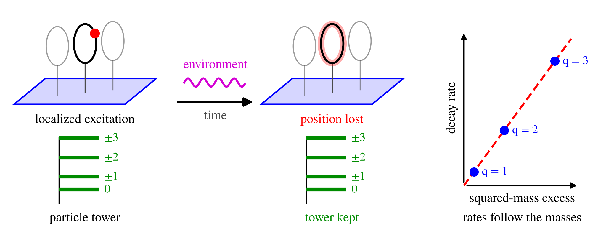

# Dynamical suppression of extra-dimensional localization in quantum field theory



Code for the article of the same title by Wahyu Rahmaniar. It draws every figure of the
article and checks the quantitative statements of the article numerically.

## Contents

| File | What it does |
|---|---|
| `figstyle.py` | Shared style: STIX (Times-like) fonts, color palette, 400 dpi output. |
| `fig_setup.py` | Fig. 1: the field on spacetime times a circle, its tower of particle species, the coupling to an environment, the density matrix of one particle, and a scattering example. |
| `fig_decay.py` | Fig. 2: decay of the harmonics of the density along the extra dimension, and a localized packet spreading round it. |
| `fig_fringe.py` | Fig. 3: drift and fading of the interference fringe of two adjacent species. |
| `fig_casimir.py` | Fig. 4: mass spectrum and decay spectrum on a sphere. |
| `verify.py` | 112 numerical checks of the theorems, propositions, rates and table entries of the article, including negative controls. |
| `run_all.sh` | Regenerates every figure and runs the checks. |

The PNG files are the outputs of the scripts beside them.

## Requirements

Python 3.10 or later with NumPy, SciPy 1.15 or later, and Matplotlib:

```
pip install -r requirements.txt
```

## Usage

```
sh run_all.sh
```

To draw one figure, run its script, for example `python3 fig_decay.py`. `verify.py` prints
one line per check, ends with `RESULT: PASS (112 checks, 0 failures)`, and exits with
status 1 if any check fails. It takes a few minutes.

Every check names the equation, theorem, proposition or section of the article that it
tests. Natural units are used throughout, with hbar = c = k_B = 1.

## Citation

Please cite the article if you use this code; `CITATION.cff` holds the author details.
